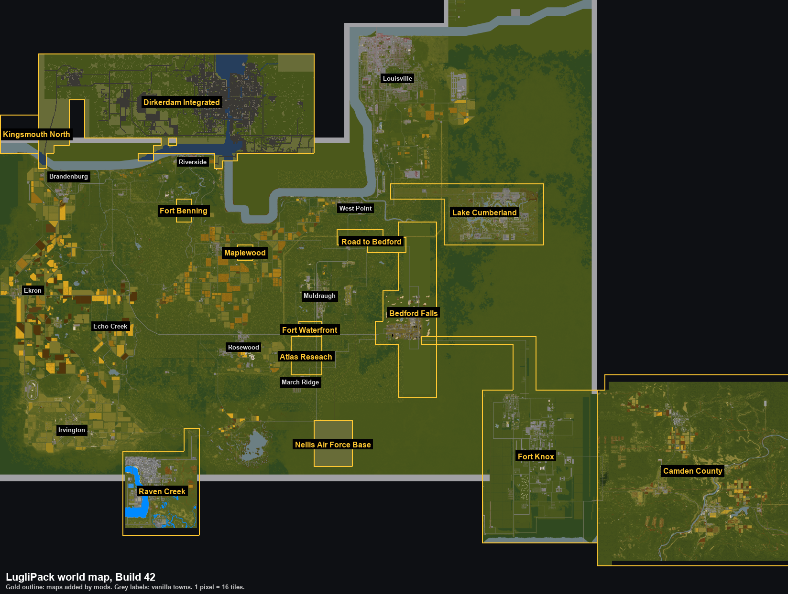

# LugliPack server config

The server settings for the [LugliPack Steam collection](https://steamcommunity.com/sharedfiles/filedetails/?id=3839272101),
for anyone who wants to host it. Build 42, dedicated server.

Vanilla Kentucky plus every map in `Map=`. Gold outlines mark the maps added by mods; where two
overlap, the one listed first in `Map=` wins.

| File | What it is |
|---|---|
| `LugliPack.ini` | Server settings, with the collection's `WorkshopItems=`, `Mods=` (in load order) and `Map=` |
| `LugliPack_SandboxVars.lua` | World and mod options |
| `LugliPack_spawnregions.lua` | Spawn towns offered to new characters |
| `world-map.png` | The whole world these maps make, at 16 tiles per pixel |

## Players: install ZombieBuddy first

The pack includes Java mods (Physical Bullets, Dead Canvas: Trauma, Tracer Location Fix, Peek a
View and Lugli Fast Loading), which run through
[ZombieBuddy](https://steamcommunity.com/sharedfiles/filedetails/?id=3619862853). Every player
needs it, once:

1. Subscribe to [ZombieBuddy](https://steamcommunity.com/sharedfiles/filedetails/?id=3619862853).
2. Windows: run the installer (`ZombieBuddyInstaller_*.exe`) from its
   [GitHub releases](https://github.com/zed-0xff/ZombieBuddy/releases/tag/windows_installer) and
   choose **Install or update ZombieBuddy**. macOS and Linux: follow its
   [manual install](https://github.com/zed-0xff/ZombieBuddy/blob/master/doc/Installation.md).
3. In the main menu's Mods list, enable
   [ZombieBuddy](https://steamcommunity.com/sharedfiles/filedetails/?id=3619862853),
   [Physical Bullets](https://steamcommunity.com/sharedfiles/filedetails/?id=3839695306),
   [Dead Canvas: Trauma](https://steamcommunity.com/sharedfiles/filedetails/?id=3836680166),
   [Tracer Location Fix](https://steamcommunity.com/sharedfiles/filedetails/?id=3789269879),
   [Peek a View](https://steamcommunity.com/sharedfiles/filedetails/?id=3710281407) and
   [Lugli Fast Loading](https://steamcommunity.com/sharedfiles/filedetails/?id=3787104045), then
   restart the game. Mods only turned on by the server load too late for some of their settings.
4. Join. ZombieBuddy asks before loading each Java mod; click **Yes** for these, and choose to
   remember the answer.

The server needs nothing extra: these mods' server side is plain Lua.

## Setup

1. Install the Project Zomboid Dedicated Server (Steam: Library > Tools, or SteamCMD app `380870`).
2. Copy the three config files into your `Zomboid/Server/` folder
   (Windows `%UserProfile%\Zomboid\Server`, Linux `~/Zomboid/Server`).
3. Open `LugliPack.ini` and fill in `Password=` (to join), `PublicName=`, and `RCONPassword=` if you use RCON.
4. Start the server with the name `LugliPack`, so it reads these files:
   `StartServer64.bat -servername LugliPack` (Windows) or `./start-server.sh -servername LugliPack` (Linux).
   The first start asks you to create the admin password.

The first start downloads 321 Workshop items and takes a while. If one download fails the
server stops booting; start it again and it resumes.

## Good to know

- **Memory:** the mod list needs a big heap. Our server runs with `-Xms8g -Xmx24g`. Set `-Xmx` in
  `StartServer64.bat` (Windows) or `ProjectZomboid64.json` (Linux), and check it again after a game
  update, which can reset it.
- **Edit settings only while the server is stopped.** It rewrites `LugliPack.ini` when it exits.
- **Adding a mod:** add its Workshop ID to `WorkshopItems=` and its mod ID (with a leading `\`) to
  `Mods=`. Keep `\ZombieBuddy` first and `\Lugli_ModpackFixes` last.
- **Whitelist:** `Open=false`, so only accounts the admin creates can join. Add one from the server
  console or RCON with `adduser "Name" "password"` (or `/adduser` in chat as admin), remove one
  with `removeuserfromwhitelist "Name"`. Set `Open=true` to let anyone with the join password in.
- **Joining** downloads every mod the server lists. Subscribing to the collection first makes the
  first join faster.
