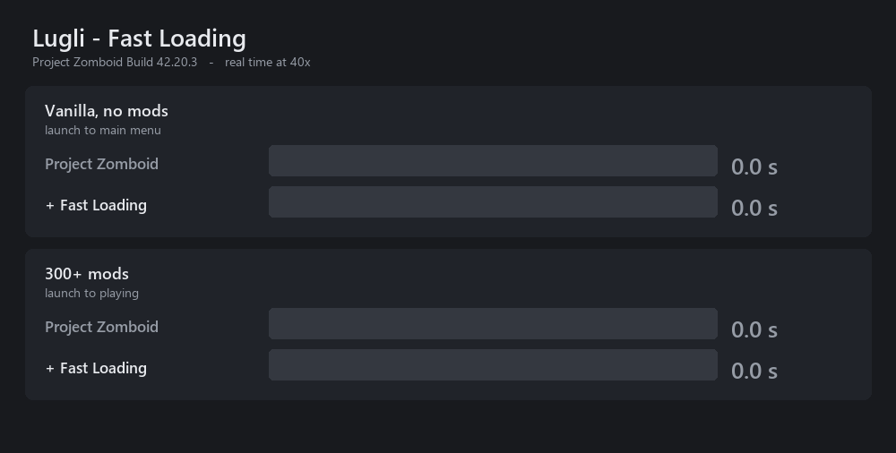

# Lugli - Fast Loading

Project Zomboid **B42** spends most of its loading time on work it does not need to do. This finds
that work in the engine and removes it. Nothing a player would notice is skipped: the item
database, the loot tables and the tilesets are fingerprinted on every build and proven identical
to an unpatched run.

Needs [ZombieBuddy](https://steamcommunity.com/sharedfiles/filedetails/?id=3619862853) for the
engine patches. Without it only the Lua parts run (the two loot fixes and one options-screen
fix), and the mod says so in the game log.

**Actively maintained.** The figures below come from one campaign and are not a ceiling. I keep
this current as Build 42 moves.



## Measured

| | without | with | delta |
|---|---|---|---|
| Vanilla, launch to main menu | 21.2 s | 13.0 s | **-39 %** |
| Vanilla, world load | 16.0 s | 14.0 s | **-13 %** |
| Vanilla, launch to playing | 37.2 s | 27.0 s | **-27 %** |
| 337 mods, launch to main menu | 47.3 s | 32.3 s | **-32 %** |
| 337 mods, world load | 83.0 s | 58.0 s | **-30 %** |
| 337 mods, launch to playing | 130.3 s | 90.3 s | **-31 %** |

Build 42.20.4, 5 s dwell at the menu, arms interleaved A,B,A,B, every run checked against its own
log, stock engine with no local-only patches. Four pairs per arm, the first of each discarded as
cold. Launch-to-playing bands: 35.6-39.0 to 26.3-27.8, and 129.3-130.8 to 87.8-90.9.

Boot and world load in a row come from **the same launches**, so the three rows of a pair add up.
No total is stacked from two separate campaigns.

It scales with mod count, not map size.

## Where the time goes

The measured model, exact to 0.01 s on both arms:

```
total = front_gap + asset_drain + gaps        asset_drain = loader_work + asset_barrier
```

Loader phases (loot merge, animals, zones, tile definitions) run *underneath* the asset pipeline,
and the barrier at the end is only the residual wait. So loader-side work was worth nothing for
most of this project's life: the 10 s distribution merge, the largest single row in any phase dump,
cost zero wall clock because textures were still decoding beneath it. Everything that mattered was
asset work, 18,795 tasks at ~2.4 ms each.

**The largest single cost was a throttle.** Every image task waits in
`TextureIDAssetManager.waitFileTask` until live direct-buffer bytes fall under a budget. Vanilla
hardcodes 50 MB. One world load spent **433.7 s of asset-worker time asleep in that gate**, blocked
on 21 % of calls, roughly half of all worker time across boot plus load.

That explained every symptom left over from three rounds of investigation: workers at 15-25 % of
a core, total CPU at 276 % of a possible 1200 %, throughput pinned near 250 tasks/s, and raising the
in-flight cap from 16 to 48 making worker CPU *fall*, because a deeper queue means more live decoded
buffers and so more crossings of the same gate. Budget ladder, interleaved, 5 s dwell:

| budget | world load | launch to playing |
|---|---|---|
| 768 MB | 54.7 s | 88.1 s |
| 1024 MB | 50.0 s | 83.6 s |
| **2048 MB** | **39.7 s** | **73.3 s** |
| 4096 MB | 40.0 s | 73.7 s |

4096 buys nothing over 2048, so peak live direct-buffer usage on a 300+ mod list is around 2 GB and
a budget above that never binds. The rule is `heap/2` capped at 2 GB.

Removing a blocker moves the wait rather than deleting it. With the budget raised, the asset barrier
collapsed from 18.6 s to 3.6 s while `loadAnimalDefinitions`, which waits on animation meshes, grew
from 4.1 s to 9.5 s. **The only score is end to end.**

## What it changes

| | instead of |
|---|---|
| Intro logos skipped | played after loading has already finished |
| Mod folder walk on up to 8 threads, override order unchanged | one folder at a time, 678 trees deep |
| Lua scan resolves a path once per folder | once per file |
| Tile geometry parsed on a worker thread | on the thread you are waiting for |
| Script tokenizer stops re-copying the file per item | 428 ms of pure copying, down to 76 ms |
| Depth-map tilesets decoded in parallel | all of them behind one global lock |
| Compiled model shaders cached | recompiled through the render thread every load |
| Vehicle textures decoded during menu time | while you are waiting to spawn |
| Buffer budget from your heap, asset pool from your cores | a hardcoded 50 MB and 4 threads |
| Loot table parsed once, after every mod has added to it | once per mod that asks, about 9 times |
| SWMG Gunworks loot insert indexed | 78.3 s, down to 8.1 s, if you run that mod |
| A real loading screen | a blank window the OS can mark unresponsive |
| Options screen opens without waiting on the render thread | blocking round-trips behind every queued upload |

Every part is behind a switch, every part reports in the game log if it could not enable itself,
and where engine code is replaced the replacement runs against the original and disables itself on
any disagreement.

## The loading screen

Vanilla writes its loading phases to the log and leaves the window blank, so a long boot looks
frozen and the OS can mark the game unresponsive. This draws a real one: progress bar, phase name,
elapsed time, and the same walking figure the world-loading screen uses.

The bar is timed from your earlier launches rather than counted in steps. The engine's phases are
very uneven, so "step 3 of 7" would sit still for twenty seconds and then jump. Each phase's
duration is written to `Zomboid/fastloading-boot.txt` and reused next launch, so from the second
boot onwards the bar moves at a rate matching your machine. It never moves backwards, by
construction, even though texture packs keep being announced throughout boot.

The figure is fetched with the same call the world-loading screen uses, so a mod that replaces that
art is picked up here too. The engine's photosensitivity notice is hidden by default because it
otherwise occupies the screen for the whole Lua phase.

## Two switches that ship off, and why

**`texcap`** makes the game's existing **Texture Size** option apply to tile packs, which a two-bit
check in the engine has always excluded. Capping pages roughly halves the texture a launch has to
upload, and it is the largest single saving measured on a heavy tile-pack list. It ships off because
you can see it: tiles are visibly softer and capped pages lose their mipmaps, so distant ground
shimmers. The headline numbers above are measured with it off. Try `512` first.

**`meshprio`** queues animation meshes ahead of textures during boot. It moves work instead of
removing it: the menu arrives ~11 s sooner and the deferred textures become what the world load
then waits on. Launch to playing, 300+ mods, interleaved:

| time on the menu | `meshprio=on` | default | |
|---|---|---|---|
| 5 s, straight through | 107.3 s | 89.0 s | 18.3 s **worse** |
| 15 s | 82.9 s | 76.8 s | 6.1 s **worse** |
| 30 s | 64.7 s | 70.6 s | 5.9 s **better** |

Break-even is around **22 s on the menu**. Most people are quicker, so it ships off. It cannot be
made adaptive: by the time the menu exists the meshes are already loaded, and the deferred textures
need elapsed wall time no priority scheme can manufacture.

## Other optimisation mods

Anything patching the same engine method collides with this, and whichever loads last wins silently.
That combination is not supported, because a fault cannot be attributed to one mod or the other.

**Zed's Better FPS NG specifically.** Checked on 42.20.4 against its 2026-08-27 build: it patches
**no method this mod patches**, so the two can be installed together. It does retransform three of
the same engine *classes* -- `GameWindow`, `Model` and `FileSystemImpl`, the last one new in that
build. If you run both and something looks wrong, turn one off before reporting it.

## Signing

The jar is **signed**, and the signing key is in ZombieBuddy's own signed author list
([`authors/ViniciosLugli.json`](https://github.com/zed-0xff/ZombieBuddy/tree/master/authors)). So
ZombieBuddy verifies it offline: no web request at launch, the author name shows in the approval
dialog, and the jar is eligible for preload. ZombieBuddy still asks once before it runs any Java
code you have not approved.

Optimizations is signed the same way.

## Switches

**JVM system properties.** They belong in the `vmArgs` list inside `ProjectZomboid64.json` in the
game folder, *not* Steam launch options, which never reach the JVM. Steam replaces that file when it
updates the game.

| switch | default | effect when set |
|---|---|---|
| `-Dfastloading.logo=keep` | on | play the intro logos |
| `-Dfastloading.watchergate=off` | on | keep the media hot-reload watcher registered |
| `-Dfastloading.parse=off` | on | use the engine's script tokenizer |
| `-Dfastloading.tilegeom=off` | on | parse tile geometry on the main thread |
| `-Dfastloading.luascan=off` | on | use the engine's Lua directory scan |
| `-Dfastloading.modwalk=off` | on | use the engine's serial mod folder walk |
| `-Dfastloading.modinfo=off` | on | resolve each installed mod folder's paths one at a time |
| `-Dfastloading.iothreads=N` | auto (cores-2, 1 to 8) | threads for the mod folder walk and path resolution, at least 1; try 1 or 2 on a hard disk |
| `-Dfastloading.assets=off` | on | use the engine's 50 MB cap and 4 asset threads |
| `-Dfastloading.assetbudget=N` | auto (`heap/2` from 4 GB of heap, `heap/4` below, min 64, max 2048) | direct-buffer megabytes before a worker sleeps |
| `-Dfastloading.menubudget=N` | 0 (off) | direct-buffer megabytes while the menu is up. Measured null on menu responsiveness and slightly worse on world load; try 256 if your menu stutters |
| `-Dfastloading.assetpoll=N` | 20 | milliseconds between budget re-checks |
| `-Dfastloading.assetcache=N` | 20 | milliseconds a live-buffer reading stays reusable |
| `-Dfastloading.assetprio=N` | auto (4 on 8 cores or fewer, else the JVM default) | asset worker thread priority, 1-10; 0 leaves the JVM default |
| `-Dfastloading.uploadcap=N` | 0 | how far the render thread may fall behind on uploads while the menu is up; 0 = no limit |
| `-Dfastloading.assetstats=on` | off | log the gate counters while they move |
| `-Dfastloading.assetstatsms=N` | 5000 | milliseconds between those lines |
| `-Dfastloading.mergestat=on` | off | count the asset queue's priority merge; diagnostic, never mutates |
| `-Dfastloading.lazyicon=on` | off | resolve item inventory icons on first use instead of at script parse |
| `-Dfastloading.texcap=N` | 0 (off) | cap texture dimensions at N pixels, tile packs included; smaller pages, blurrier tiles |
| `-Dfastloading.demandprio=off` | on | queue textures the player just asked for behind background ones |
| `-Dfastloading.demandband=N` | 9 | priority for a texture requested while the menu is up |
| `-Dfastloading.bulkband=N` | 3 | priority for the vehicle warm's textures |
| `-Dfastloading.demandwindow=N` | 2000 | milliseconds background asset work stands down after a demand request |
| `-Dfastloading.meshprio=on` | off | queue animation meshes ahead of textures, for boot only |
| `-Dfastloading.meshband=N` | 8 | priority the mesh raise uses |
| `-Dfastloading.assetcap=off` | on | use the engine's 16-task in-flight asset cap |
| `-Dfastloading.assetcapn=N` | auto (5 per asset thread, 16 to 48) | how many asset tasks may be in flight when it is on |
| `-Dfastloading.assetcapms=N` | 600000 | backstop: end the raise this long after it starts, if the menu never reports |
| `-Dfastloading.querycache=off` | on | ask the render thread again for a capability answer that cannot change |
| `-Dfastloading.shadercache=off` | on | recompile model shaders every load |
| `-Dfastloading.tiledepth=off` | on | decode depth tilesets inside the global lock |
| `-Dfastloading.vehtex=off` | on | load vehicle textures during world load |
| `-Dfastloading.vehtexslice=N` | 32 | vehicle scripts warmed per slice |
| `-Dfastloading.vehtexinterval=N` | 100 | milliseconds between warm slices |
| `-Dfastloading.vehtexquiet=N` | 0 | absolute pending-task gate for the warm; 0 disables it |
| `-Dfastloading.vehtexdelay=N` | 1500 | milliseconds of menu time before the warm starts |
| `-Dfastloading.vehtexhigh=N` | 75 | percent of the buffer budget above which the warm stands down |
| `-Dfastloading.progress=off` | on | no loading screen |
| `-Dfastloading.progressms=N` | 80 | milliseconds between loading-screen frames |
| `-Dfastloading.progressidle=N` | 120000 | safety cap: stop drawing this long after the last phase |
| `-Dfastloading.warningms=N` | 0 | photosensitivity notice: 0 hides it, >0 shows it for N ms, -1 lets the engine draw its own |
| `-Dfastloading.walktexture=PATH` | media/ui/Progress/MaleWalk2.png | the animation on the loading screen |
| `-Dfastloading.artpumpms=N` | 300 | milliseconds between the bounded pumps that fetch the loading art |
| `-Dfastloading.artpumpwindow=N` | 8000 | milliseconds into boot after which those pumps stop |
| `-Dfastloading.logstat=off` | on | check the log file size on every written line |
| `-Dfastloading.luaindex=off` | on | use the engine's linear scan of loaded Lua files |
| `-Dfastloading.gunidx=off` | on | search the Gunworks tables per insert instead of indexing |
| `-Dfastloading.lootinit=off` | on | let every mod re-run the loot parse from its own handler |
| `-Dfastloading.menucalls=off` | on | rebuild the key-name table every time the options screen opens |

On a **dedicated server** none of these apply: the jar does not load there. The two Lua parts are
switched from Lua instead -- set `FastLoadingDisableGunIndex = true` or
`FastLoadingDisableLootInit = true` from any server Lua file.

## Layout

```
art/                      the published explainer images
java/lugli/fastloading/   the mod source, one file per part
lua/                      the two loot fixes and the main-menu hooks
mod.info                  the in-game manifest
workshop.txt              the Steam listing, BBCode
```

MIT. Part of [PZWorkspace](https://github.com/ViniciosLugli/PZWorkspace).
