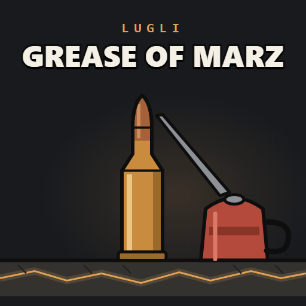

# Lugli - Grease of Marz



Unofficial fixes for the Gunworks and Guns of Marz gun stack on Build 42. Not made by, or
affiliated with, the authors of those mods. Lua only, no jar, no `require=`.

## What it fixes

| Fix | Turns on when | What it does |
|---|---|---|
| LootIndex | Gunworks (`SWMG`) | Guns of Marz adds its guns to the loot tables through Gunworks' `Distribution.Insert`, which walks every loot table and asks every script item its name on each call. This replaces it with an indexed version that is checked against the original before it installs, and falls back to the original walk if the two ever disagree. |
| ReloadStart | Gunworks and Ultimate Marksman (`UltimateMarksman`) | Ultimate Marksman redefines `ISReloadWeaponAction:start` without calling the previous one, so Gunworks' `onReloadStart` (the reload prop in the off hand) never runs on guns without a magazine. This wraps the final `start` and runs that step only when the chain below did not, so it never runs twice. |
| RunAndReload | Gunworks and Run and Reload (`Run and Reload`) | Gunworks tells a reload's steps apart (opening stroke, round into the chamber, closing stroke) by values it adds to the reload action constructors, and loads a magazine with a chosen ammo type and round limit the same way (Easy Spare Magazine Reload adds one more value there). Run and Reload redefines those constructors in client Lua without calling them, so every step reads as a plain rack or load and the reload rules add strokes again until Gunworks stops them after six: lever, bolt and pump guns rack and reload over and over, and a magazine ignores the ammo type and limit. In multiplayer the server builds each action from the parameters the client's final constructor names, so it runs every stroke as a full rack and throws a live round out. This puts back the constructors Run and Reload replaced, so each action is built and sent to the server as the mods below it define, and applies Run and Reload's flags when the action is created, so reloading on the move still works. Client only: a dedicated server never loads Run and Reload's client Lua. |
| Headhunter | Guns of Marz (`GunsOfMarz`) and Undead Survivor (`UndeadSuvivor`) | The Headhunter and Deadly Headhunter rifles take `Base.308Bullets`, `Base.M14Clip` and `Base.308Box`, which Guns of Marz converts into its own items. When the world's sandbox settings convert the .308 round or the M14 magazine, both rifles take Guns of Marz's M14 set instead: `SWMG.762x51_Bullet`, `MarzGuns.762x51Magazine20_M14`, `MarzGuns.762x51_Box`. Decided per world, after the sandbox is loaded and before any item is. A gun reads these from its script when it is created or loaded, so rifles already in a save change too. |
| AttachmentsUI | Gunworks, Guns of Marz and Attachments UI (`AttachmentsUI`) | Attachments UI's workbench works on these guns without a hand-made weapon patch. It lists a slot only when an item script's text names the gun, so the Picatinny rail slots Guns of Tien adds at runtime never showed and the rail could not be fitted: every rail position Gunworks registers for a gun now gets its slot. Guns of Marz and Guns of Tien build their pistols, revolvers and machine pistols sights-down, as vanilla's handguns are, but the workbench only recognises vanilla's, so they showed upside down: for models of those two mods it reads up from the sight and the barrel instead, and frames them at vanilla's handgun zoom. A patch you saved with a vertical flip to turn one of them upright keeps looking the same: that flip is dropped as the patch loads, never from the file. Your other patch settings apply as before. An empty slot whose card line ended at the gun's centre now ends at the gun's own attachment point for it (`rail_left`, `light_left`, `laser_right`, ...), or at the rail the part mounts on. Gunworks bayonets attach only through their own right-click entry, so their slot, which could only say "Blocked", is hidden. |

`shared/FastLoading_Gunworks.lua` is the same file Lugli - Fast Loading ships, at the same path,
so with both mods active only one copy runs.

## Multiplayer

The fixes are `shared/` Lua, so they run on the server and on each client; install it on both.
AttachmentsUI is `client/` Lua: the workbench is client-side. RunAndReload registers only on
clients: Run and Reload's constructors exist only there.

## Checking that it loaded

The console prints one line at boot:

```
[Lugli/GreaseOfMarz] loaded [build <date> (<files>)], 5 part(s): AttachmentsUI: installed; Headhunter: installed; LootIndex: installed; ReloadStart: installed; RunAndReload: installed.
```

Each fix is `installed`, `skipped: <mod> not active`, or `failed: <reason>`. A failed fix leaves
the game as it would be without this mod. Two more lines follow at world load:
`[Lugli/GunworksLoot] ... Insert() replaced, self-test passed` and
`[Lugli/GreaseOfMarz] Headhunter: retargeted ...` (or `stock: ...` when the sandbox leaves the
vanilla ammo alone).

## Licence

MIT. No file from Gunworks, Guns of Marz, Guns of Tien, Attachments UI, Ultimate Marksman, Run and
Reload or Undead Survivor is included; the fixes reach their code only through what those mods
expose at runtime.
