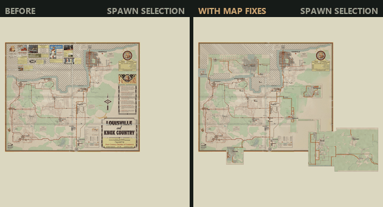
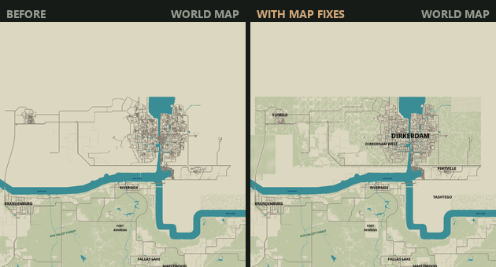
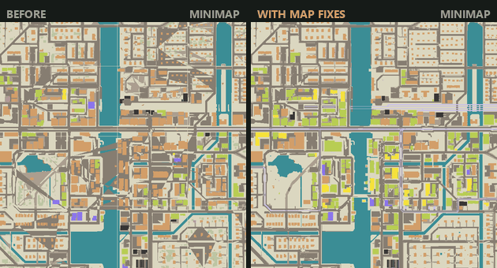

# Lugli - Map Fixes & Alignment

A cleaner world map, minimap and spawn screen for popular Build 42 map mods. Presentation only:
no lot, loot, zone or save is touched, so it can be added to or removed from a save at any time.

## What it does

- **World map and minimap.** Each supported map is redrawn from its own lots: roads, buildings
  coloured by room type, parks, forest and water. Most roads that stopped at a cell edge or a map
  border now continue across it, and misdrawn road shapes (the wedges across Dirkerdam and Camden) are cut
  back to the carriageway. Zoomed out, the game draws every map's forest image at once, so
  vanilla's woods used to show through a map's towns and fields wherever it replaced vanilla land;
  a clearing layer now repaints those squares. Like vanilla's, the minimap draws no forest. The
  map's own files are never edited: the redrawn data sits beside
  them in `media/maps/<map folder> (Lugli)/` and the loaders are pointed at it.
- **Spawn screen.** Each map gets a paper preview in vanilla's style and scale, drawn over
  vanilla's Kentucky map: it takes on that map's aged paper, its roads run on into vanilla's, and
  any of vanilla's panels (ads, captions, the title card) it would cut through is cleared away whole,
  the paper or hatching around it carried into its place; the view opens wide enough to show every listed map, and selecting a
  map centres on its main town.
- **Spawn screen text.** Each map's title and description there are rewritten in one style
  (placeholder titles such as "Build 42 TEST" become the map's name), with a line saying this
  add-on presents them. These are translation files, not a part: they apply whenever the mod is
  enabled, even if a part fails.
- **Town labels** for maps whose own annotations name none (Dirkerdam, Nellis, Atlas). A town
  another mod already names is not named twice.

## Maps

| Map | Author |
|---|---|
| [Dirkerdam Integrated B42](https://steamcommunity.com/sharedfiles/filedetails/?id=3818766091) | Byceicle |
| [Camden County Relocated](https://steamcommunity.com/sharedfiles/filedetails/?id=3840538942) | Midgar |
| [Raven Creek B42](https://steamcommunity.com/sharedfiles/filedetails/?id=3484263516) | BuchoJefe |
| [Fort Benning B42](https://steamcommunity.com/sharedfiles/filedetails/?id=3490580478) | BuchoJefe |
| [Fort Waterfront B42](https://steamcommunity.com/sharedfiles/filedetails/?id=3486814612) | BuchoJefe |
| [Nellis Air Force Base](https://steamcommunity.com/sharedfiles/filedetails/?id=3783433804) | antony |
| [Atlas Underground Complex](https://steamcommunity.com/sharedfiles/filedetails/?id=3717208771) | SD JUAN |
| [Fort Knox](https://steamcommunity.com/sharedfiles/filedetails/?id=3840538850) | Midgar |
| [Bedford Falls](https://steamcommunity.com/sharedfiles/filedetails/?id=3840538889) | Midgar |
| [Road to Bedford](https://steamcommunity.com/sharedfiles/filedetails/?id=3840538893) | Midgar |
| [Lake Cumberland](https://steamcommunity.com/sharedfiles/filedetails/?id=3840538895) | Midgar |
| [Kingsmouth North](https://steamcommunity.com/sharedfiles/filedetails/?id=3840538926) | Midgar |
| [Maplewood](https://steamcommunity.com/sharedfiles/filedetails/?id=3644794945) | Kyber |

All credit for the maps goes to their authors. This is an unofficial add-on, not made or
endorsed by them; every file it ships is derived from the maps' own files.

## Compatibility

No hard dependencies. Every part is tied to its map's mod and installs only when that mod is
active, so any subset of the maps works; maps not on the list keep their own drawing.

- **Old Dirkerdam Map Fix.** This mod replaces it. While it is active, Dirkerdam's world map and
  minimap data are left to it (the part reports `skipped`), so the two never mix.
- **A map's mod active but its folder not in `Map=`.** Its labels and previews stay out.
- **A spawn screen without Muldraugh** (a server whose `Map=` leaves vanilla out). The previews
  replace the game's vector view only when every listed map has one; otherwise the vector view
  stays, so an unknown map is still drawn.
- **Replacement minimaps** that build their own minimap from the lot folders (TwisTonFire
  Minimap) show the maps' original data there; the world map and spawn screen are unaffected.
- **Multiplayer.** Only client code does anything; on a dedicated server no part installs.

## Checking that it loaded

The console prints one line at boot. It opens with `[Lugli/MapFixes] loaded [build `, then
the date the mod was built and every part with its state: `installed`, `skipped` with the
mod it waits for or yields to, or `failed` with the error. A failed part leaves what it draws
exactly as it was without this mod.
