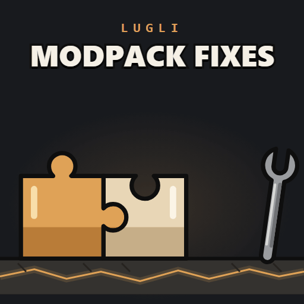

# Lugli - B42 Modpack Compats & Fixes



Fixes for conflicts between popular Build 42 mods, for bugs inside some of them, and for one vanilla
bug they run into. Not made by,
or affiliated with, the authors of those mods. Lua and data only, no jar, no `require=`.

## How a fix decides to run

Each fix is a part with its own sandbox switch, under **Lugli - Modpack Compats & Fixes**. A part
installs only when:

1. every mod it fixes is active,
2. its switch is on,
3. the lines it depends on in those mods still hash to the version it was written against.

A mod update that changes those lines makes the part stand down instead of guessing. A part that
errors while running takes its changes back and leaves the game as it is without this mod.

## What it fixes

| Switch | Turns on with | What it does |
|---|---|---|
| SgKills | Super Gore (`Super_Gore_by_mrdocs`) | Super Gore settles a hit a tick later and finishes the zombie with `Kill()`, which credits nobody. A zombie that dies that way is added to its attacker's zombie kills, and in multiplayer the server sends the same kill change the engine sends for a normal kill. Bleed-outs stay uncounted, as fire deaths are in vanilla. |
| SgTank | Super Gore and Special Zombies: Tank (`SpecialZombiesTankB42`) | Both mods hold back a weapon hit's damage and settle it on the next tick, and together a Tank dies to almost any hit or gains health when a limb is cut. Super Gore leaves Tanks to their own mod. |
| HotbarEquip | SwapIt, with Fancy Handwork (`FancyHandworkB42_19`) or H.E.C.U. (`H_E_C_U`) | SwapIt replaces the hotbar's equip step, which drops Fancy Handwork's modifier + hotbar key (take into the off hand) and H.E.C.U.'s hotbar key on helmets and masks (put on, take off). Both come back on top of SwapIt. |
| BpHotbar | SwapIt and Better Pause (`twistbetterpause`) | Better Pause removes the pause check from the hotbar; SwapIt's copy of that function puts it back, and it always loads later. Hotbar keys work while paused again, with vanilla's other checks. |
| FhKeys | Fancy Handwork B42.20 (`FancyHandworkB42_19`) | Its key handler throws on every key press on 42.22 and its swap-hands keys do nothing. The handler is replaced with a working one that queues the same action. |
| ReloadStrap | Vanilla; off while Reload Strap Fix (`ReloadStrapFix`) is active | With an ALICE belt or chest rig worn (or an ammo case equipped), two errors skip the reload speed: reloading a shotgun or revolver without an ammo strap, and filling or emptying a magazine while holding anything that is not a weapon. Both get the speed vanilla's checks mean, and mods that change reload speed (Ultimate Marksman's bows and crossbows) still apply theirs. Works beside Reload Those Weapons Again (`ReloadBackAgain`), which since its 2026-11-17 update fixes both. |
| SlingStop | Alice's Weapon Sling (`alicesWeaponSling`) | Cancelling a hotbar attach partway (by running, for example) leaves the weapon model on the body but off the hotbar. Vanilla's cleanup runs again before the sling's own stop. |
| BiiTooltip | Better Item Info (`EURY_ITEMINFO`) and Guns of Marz (`GunsOfMarz`) | Better Item Info resets the item tooltip at world start when Guns of Marz is active, hiding rows other mods add (backpack upgrades, seed seasons, silencer durability). They stay. |
| IdpHide | Item Details Panel (`ItemDetailsPanel`) | Item Details Panel draws its panel beside the vanilla item tooltip unless its Hide vanilla tooltip option is ticked. That option starts ticked, so the panel replaces the tooltip; a player who already set it keeps their choice. |
| IdpText | Item Details Panel | With the vanilla tooltip hidden, an item's description (including text other mods set, such as a lit flare's burn time), its mod (with the game's Show item mod info option) and a weapon part's slot and the guns it fits show nowhere. They show in the panel. |
| IdpVanilla | Item Details Panel | With the vanilla tooltip hidden, some vanilla rows show nowhere: a clock's time and alarm, raw meat's and tainted food's warnings, what a book or magazine teaches and whether it was read, a skill book's XP levels, a fishing rod's line, hook and bait, an SCBA's tank, and the crafting notes (can research, favourite recipe input, flagged unusable or unwanted). They show in the panel, warnings in its Attention section and the rest in Clock, Reading, Teaches, Fishing and Crafting groups. Teaches names each recipe once, marked Known or New, and a list longer than eight ends in a count of the rest and how many of them are known, then a "Full list: Hold Alt" tip. Holding that key over the item lists every recipe. The key is in Options, Mods, Lugli - Modpack Compats & Fixes ("Show a book's full recipe list"); unbinding it removes the tip. |
| IdpChamber | Item Details Panel | With the vanilla tooltip hidden, a loaded gun with nothing chambered no longer warns that it needs racking, and spent rounds in a gun go uncounted. Both show in the panel's Attention section, under vanilla's rule. |
| IdpMarz | Item Details Panel and Guns of Marz (`GunsOfMarz`) | With the vanilla tooltip hidden, Guns of Marz's red Information block (ammo, rails, muzzle device, bayonet, and Guns of Tien's fitted parts) is gone. It shows in the panel. |
| IdpSilencer | Item Details Panel and Improvised Silencers (`ImprovisedSilencers`) | With the vanilla tooltip hidden, a suppressor's noise reduction, condition bar and description are gone, on the suppressor and on a gun that has one. They show in the panel. |
| IdpBags | Item Details Panel and Dynamic Backpack Upgrades (`LazoloDynamicBackpackUpgrades`) | With the vanilla tooltip hidden, a bag's free upgrade slots and upgrade bonuses, and what an upgrade item adds, are gone, and looking at a bag no longer restores its upgraded stats. The lines show in the panel and the stats are restored as before. |
| IdpSeeds | Item Details Panel and Seed Season Indicator (`SeedSeasonIndicator`) | With the vanilla tooltip hidden, a seed's This month status and bad months are gone (the panel already shows the other season rows). They show in a Sowing season group of the main panel, green for a good month and red for a risky or wrong one. |
| IdpRadial | Item Details Panel and Smart Radial Menu (`SmartRadialMenu`) | With the vanilla tooltip hidden, the coloured lines a highlighted radial slice adds to its item tooltip are gone. They show in the panel. |
| IdpRpm | Item Details Panel and Gunworks (`SWMG`) | Gunworks guns (Guns of Marz and its add-ons) fire at their own rate, which no tooltip shows. The panel's Common section shows the current rate of fire in rounds per minute, and which rate is selected on a gun with several. |
| P4Place | Better Item Transfer (`BetterItemTransfer`) and Picking Meister (`P4PickingMeister`) | Better Item Transfer renames Place Item to Place, so Picking Meister's Grab and Unpack Contents entry drops to the bottom of the menu or goes missing. It is back beside Drop and Place, which Better Item Transfer keeps together. |
| CleanUIBlink | CleanUI (`CleanUI`) | CleanUI's inventory window has no `setBlinkingContainer`, so the vanilla tutorial errors when it points at a container. The method is added with vanilla's meaning, drawn as a pulsing overlay over CleanUI's container buttons. |
| AuiCleanUI | Attachments UI (`AttachmentsUI`) and CleanUI (`CleanUI`) | The weapon workbench keeps its own flat look beside CleanUI's windows. While CleanUI's clean inventory is on, the workbench, part picker, presets and patch editor draw with CleanUI's title bar, background, border and buttons, at the opacities set in CleanUI's options. Attachments UI's own options are not touched. |
| SeatView | Clear Driver View Fix (`ClearDriverViewFix`) and Vehicle Seat UI (`VSUIKI5`) | KI5's seat UI replaces the seat diagram's drawing and drops Clear Driver View Fix's guard, so the diagram flashes when you start driving. It stays hidden while you drive with the engine on. |
| UsItems | Undead Survivor (`UndeadSuvivor`) | Its three gas masks are deleted once the filter comes out, and its Stalker knife cannot be sharpened. The masks behave like vanilla gas masks, and the sharpening recipes take the knife. |
| UsDrops | Undead Survivor | In multiplayer every client adds its own random loot to Undead Survivor's outfit zombies, which shows in the corpse but cannot be taken. The loot is left to the server. |
| VmzLegacy | Vehicle Military Zones (`VMZNEW`) and Yet Another PZ Library (`YAPZLib`) | Vehicle Military Zones still ships an old zone script that calls library functions which no longer exist, so every world load throws an error. Its zone changes already come from its newer script; the old one no longer runs. |
| VehicleLoot | Specific Loot (`SpecLoot`) | Its rewritten loot files leave six burnt wrecks, seven Ford F350/F450 work trucks, the '49 Power Wagon PA and the '63 Type 2 Van Apocalypse with empty containers. The wrecks get their live vehicle's loot, the two KI5 variants the loot their own mods give them, and the trucks vanilla work, mechanic, construction or ambulance loot. |
| SealedSeats | '84 Cadillac Gage LAV-300 (`84gageV300`), '85 Chevy Step Van (`85chevyStepVan`) or '63 Beetle (`63beetle`) | The LAV-300's seats, driver's seat included, and the Step Van SWAT's crew seats can never be opened, yet Specific Loot rolls loot into them, both at spawn and in its own re-roll, and on the LAV-300 making room in a seat pushes its items into the next sealed one; a seat holding items can never be sat in. The '63 Beetle Buggy keeps the Beetle's inner trunk, which opens only from rear seats or a door area the two-seat buggy does not have, and both mods' loot tables fill it. Nothing goes into any of them any more, and what is already in them is moved to the vehicle's trunk when it loads. The buggy's inner trunk counts as sealed only while the buggy still has no way into it. |
| LootNames | Vanilla | Vehicle loot tables, mostly Specific Loot's and the KI5 vehicle mods' own, name items by names that no longer exist (`Gloves_LeatherGloves_Black`, `ShirtFormalTINT`, `DehydrateMeatStick`, `EmptyPetrolCan`, `AssaultRiffle`, `WhiskeyFull`, `Cigarettes`, the Oshkosh `Hoodie_*`, `W460MilitaryTire`), and the game drops each one silently, so those items never spawn. Vanilla's Genuine Beer step van points at a loot table no file defines and spawns empty. Each name is replaced by its successor while the old name resolves to no item and the new one does, and the beer van gets its own table while it has none. |
| TileProps | More Damaged Objects (`MoreDamagedObjects`) or Raven Creek (`RavenCreekB42`) | Both replace whole vanilla tilesets with older copies: some street lights stop lighting, hedges cannot be picked up, ladders, fences and signs lose properties, town signs lose their two-tile pickup. Every lost vanilla property is put back when the tiles load, only where the sprite still holds what the mod gave it, so a later fix wins. Wind sway is a Java field and stays as the mod has it. |
| GydeHandy | Gyde's Trait Magazines (`GydeTraitMags`) and Extended (`GydesTraitMagazinesExtended`) | With both active, the Handy magazine gives the trait but not the four skill levels Extended adds. Extended handles that magazine, as it intends. |
| DbuRestore | Dynamic Backpack Upgrades (`LazoloDynamicBackpackUpgrades`) | The game never saves a bag's capacity, and the mod puts upgraded capacity back only from client Lua, so after a server restart or a rejoin the server refuses items past a bag's original capacity while the bag shows the upgraded one. The server puts the recorded capacity back every in-game minute, for every bag its players carry, bags inside bags included. |
| ExBandolier | Explosives (`Explosives`) | Its full grenade bandolier, worn by its grenadier zombies and found in its loot, becomes an empty bandolier plus grenades only in client Lua, which a dedicated server never runs, and the server is what fills corpses and containers in multiplayer. So on a server the bandolier stays full and holds nothing. The server does the same swap, with the mod's own odds, and tells the clients the full one is gone. |
| ImpSpawn | '67 Chevy Impala (`67chevyImpala`) | Its spawn list puts a vehicle name it does not define into six parking, traffic and junkyard zones, so the Impala never spawns there, and a roll that lands on that name leaves the spot empty. The sedan takes those entries, with the mod's own chances. |
| UsmilSeats | damnlib (`damnlib`) | Its two seat repairs (duct tape, needle and thread) name seats that do not exist, so the seats of its military vehicles can never be repaired. Both repairs also accept the real seats, with damnlib's own tools and skills. |
| NellisPower | Nellis Air Force Base (`NellisAFB`) | Every player's game keeps the generator in each of its 11 aircraft and vehicle interiors fueled and running, so in multiplayer each client sends all of them to the server every in-game minute, and the server's copy is whatever a client last sent. It fills any generator inside, so one carried in comes out full, as often as a player likes. The server does it instead, writing only what changed, and only for the generator each interior came with; one placed there later, the original put back included, is left alone. Clients no longer write generators. |
| NellisExit | Nellis Air Force Base | Enter remembers where you came from only in your own game. On a server that record is lost on a relog or a server restart, and a player inside an interior is shut in, since Exit then has nowhere to go. The server keeps the record and gives it back; with none known, Exit takes you to Nellis' spawn point. Enter and Exit are otherwise unchanged. |
| DbuCeiling | Dynamic Backpack Upgrades | A bag reads back at most 50 (less its own weight). Past that the mod always offers Fix Upgrades for it, and with Fix Always it sets the capacity again every in-game minute, logging a warning each time. The bag counts as fixed at the most the game keeps, until its upgrades change. |
| NgmSlice | Nick's Generator Manager (`NicksGeneratorManager`) | Every in-game minute, and on every claim, it walks every square in range of every running generator to find what to bill, all in one tick, on the server and on each player's game: about 8 ms per generator. That walk is spread over a few ticks. The same squares and rules decide the bill; it lands a few ticks later. |
| NgmNeat | Nick's Generator Manager and Neat Rocco's UI (`Neat_Rocco`) | Neat Rocco's generator window lists every appliance in range, also the ones another generator pays for, so the list does not match its Total. It lists what Nick's Generator Manager bills to that generator, with numbers printed like the window's own base and Total lines. |
| NgmInfo | Nick's Generator Manager | Nick's Generator Info list prints ".0008 L/h" under base and Total lines that read "0.0028 L/h", and a Badlands Power battery bank lists every appliance in range instead of what it pays for. Every generator's Info text and right-click tooltip lists Nick's bill, printed the way the game prints its own numbers. |
| NgmManage | Nick's Generator Manager and Neat Rocco's UI | Nick's Manage Power window is a vanilla window beside Neat Rocco's generator window, and while it is open it walks every square around the generator twice a second, a hitch each time. It opens as a Neat Rocco window: Neat header, list rows with checkboxes, icon buttons with tooltips, resize handle. The rows, claims, returns and the server's refresh are Nick's own. The square walk runs on open and every 5 s; rows that stop being billed drop out at once, and an appliance switched on shows up within 5 s. On a server with NgmClaims on, what the server would refuse is greyed out, with the reason under the summary, and Return all leaves out what a generator the player cannot manage claimed. |
| NgmClaims | Nick's Generator Manager | In multiplayer the server applies every Manage Power change as sent: any player, from anywhere, can make any generator pay for any appliance, also a generator in someone else's safehouse, so its fuel burns for another player's fridge. The server accepts a change only from a player inside that generator's power range, and leaves out any generator or appliance in a safehouse the player is not allowed in (its owner, its members, and staff whose role may enter safehouses are). Refusals are logged once a minute with the players' names. Single player is not affected. |
| BpNeat | Badlands Power (`BadlandsPower`) and Neat Rocco's UI | Neat Rocco's generator window reads "Gas-powered Generator" in its title and above its Total for every generator, and shows the battery bank as a fuel tank. The title and that line keep the Badlands name, and the bank keeps Neat Rocco's panel with a stored-charge bar and Badlands Power's text below it: batteries, consumption, charging and safety. |

## For server admins

| Switch | Turns on with | What it does |
|---|---|---|
| SrvProf | A dedicated server whose cache folder holds `Lua/serverprof-on.txt` | Every mod message from the server to players leaves as the same packet type, so the server's own network statistics cannot say which mod is sending the most. With that file present, `sendServerCommand` and `ModData.transmit` are counted per mod command (or ModData key): calls, players reached, and an estimate of the bytes sent. Once a minute the counts go to `Lua/serverprof-sends.txt` as tab-separated rows. Create or delete the file at any time; it is checked once a minute. Without it, the part only checks for the file. A mod that kept its own copy of `sendServerCommand` before this mod loaded is not counted, so list this mod last. |

## Data fixes

These are vanilla files shipped unchanged, so they win over a mod's older copy. They have no
switch, and they need this mod to load after the mod they correct.

- `clothing/clothingItems/Hoodie_Hide_DOWN.xml`, `Hoodie_HuntingCamo_DOWN.xml`: Fluffy Hair's
  copies point the hood-down hoodies at the hood-up textures.
- `AnimSets/player/getup/fromSitOnGround.xml`: Get Up Quick's copy predates the events that hide
  what you hold while you stand up from the ground.

## Load order

Anywhere after the mods it fixes. The end of the list is simplest.

## Multiplayer

Install it on the server and on every client. Each part runs on the side its fix needs: the
Super Gore and loot parts on the server, the hotbar and menu parts on clients.

## Checking that it loaded

The console prints one line at boot:

```
[Lugli/ModpackFixes] loaded [build <date>], <n> part(s): <part>: <state>; ...
```

Each state is `installed`, `skipped: <reason>` (a mod it fixes is not active, or its switch is
off), `tripped: <reason>` (the pinned lines changed, or another mod's or the game's code is not
what the fix needs, so it stood down silently and took any changes back), `open: <error>` (it
failed while running and took its changes back) or `failed: <error>` (it failed to install).

## Licence

MIT. No file from any of the mods it fixes is included; the parts reach their code only through
what those mods expose at runtime. The data fixes are Project Zomboid's own files.
