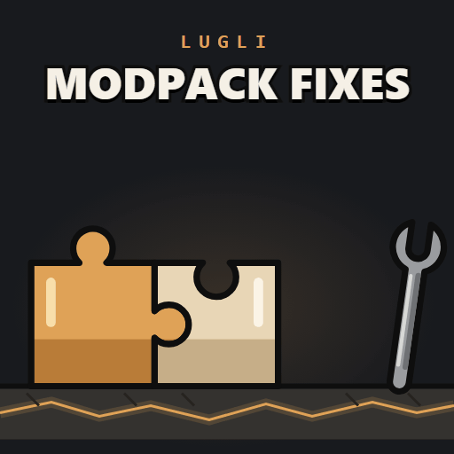

# Lugli - B42 Modpack Compats & Fixes



Fixes for conflicts between popular Build 42 mods, and for bugs inside some of them. Not made by,
or affiliated with, the authors of those mods. Lua and data only, no jar, no `require=`.

## How a fix decides to run

Each fix is a part with its own sandbox switch, under **Lugli - Modpack Compats & Fixes**. A part
installs only when:

1. every mod it fixes is active,
2. its switch is on,
3. the lines it depends on in those mods still hash to the version it was written against.

A mod update that changes those lines makes the part stand down instead of guessing. A part that
errors while running takes its changes back and leaves the game as it is without this mod.

## What it fixes

| Switch | Turns on with | What it does |
|---|---|---|
| SgKills | Super Gore (`Super_Gore_by_mrdocs`) | Super Gore settles a hit a tick later and finishes the zombie with `Kill()`, which credits nobody. A zombie that dies that way is added to its attacker's zombie kills, and in multiplayer the server sends the same kill change the engine sends for a normal kill. Bleed-outs stay uncounted, as fire deaths are in vanilla. |
| SgTank | Super Gore and Special Zombies: Tank (`SpecialZombiesTankB42`) | Both mods hold back a weapon hit's damage and settle it on the next tick, and together a Tank dies to almost any hit or gains health when a limb is cut. Super Gore leaves Tanks to their own mod. |
| HotbarEquip | SwapIt, with Fancy Handwork (`FancyHandworkB42_19`) or H.E.C.U. (`H_E_C_U`) | SwapIt replaces the hotbar's equip step, which drops Fancy Handwork's modifier + hotbar key (take into the off hand) and H.E.C.U.'s hotbar key on helmets and masks (put on, take off). Both come back on top of SwapIt. |
| BpHotbar | SwapIt and Better Pause (`twistbetterpause`) | Better Pause removes the pause check from the hotbar; SwapIt's copy of that function puts it back, and it always loads later. Hotbar keys work while paused again, with vanilla's other checks. |
| FhKeys | Fancy Handwork B42.20 (`FancyHandworkB42_19`) | Its key handler throws on every key press on 42.22 and its swap-hands keys do nothing. The handler is replaced with a working one that queues the same action. |
| SlingStop | Alice's Weapon Sling (`alicesWeaponSling`) | Cancelling a hotbar attach partway (by running, for example) leaves the weapon model on the body but off the hotbar. Vanilla's cleanup runs again before the sling's own stop. |
| BiiTooltip | Better Item Info (`EURY_ITEMINFO`) and Guns of Marz (`GunsOfMarz`) | Better Item Info resets the item tooltip at world start when Guns of Marz is active, hiding rows other mods add (backpack upgrades, seed seasons, silencer durability). They stay. |
| P4Place | Better Item Transfer (`BetterItemTransfer`) and Picking Meister (`P4PickingMeister`) | Better Item Transfer renames Place Item to Place, so Picking Meister's Grab and Unpack Contents entry drops to the bottom of the menu or goes missing. It is back beside Drop and Place, which Better Item Transfer keeps together. |
| CleanUIBlink | CleanUI (`CleanUI`) | CleanUI's inventory window has no `setBlinkingContainer`, so the vanilla tutorial errors when it points at a container. The method is added with vanilla's meaning, drawn as a pulsing overlay over CleanUI's container buttons. |
| SeatView | Clear Driver View Fix (`ClearDriverViewFix`) and Vehicle Seat UI (`VSUIKI5`) | KI5's seat UI replaces the seat diagram's drawing and drops Clear Driver View Fix's guard, so the diagram flashes when you start driving. It stays hidden while you drive with the engine on. |
| UsItems | Undead Survivor (`UndeadSuvivor`) | Its three gas masks are deleted once the filter comes out, and its Stalker knife cannot be sharpened. The masks behave like vanilla gas masks, and the sharpening recipes take the knife. |
| UsDrops | Undead Survivor | In multiplayer every client adds its own random loot to Undead Survivor's outfit zombies, which shows in the corpse but cannot be taken. The loot is left to the server. |
| VmzLegacy | Vehicle Military Zones (`VMZNEW`) and Yet Another PZ Library (`YAPZLib`) | Vehicle Military Zones still ships an old zone script that calls library functions which no longer exist, so every world load throws an error. Its zone changes already come from its newer script; the old one no longer runs. |
| VehicleLoot | Specific Loot (`SpecLoot`) | Its rewritten loot files leave six burnt wrecks and seven Ford F350/F450 work trucks with empty containers. The wrecks get their live vehicle's loot, and the trucks vanilla work, mechanic, construction or ambulance loot. |
| TileProps | More Damaged Objects (`MoreDamagedObjects`) or Raven Creek (`RavenCreekB42`) | Both replace whole vanilla tilesets with older copies: some street lights stop lighting, hedges cannot be picked up, ladders, fences and signs lose properties, town signs lose their two-tile pickup. Every lost vanilla property is put back when the tiles load, only where the sprite still holds what the mod gave it, so a later fix wins. Wind sway is a Java field and stays as the mod has it. |
| GydeHandy | Gyde's Trait Magazines (`GydeTraitMags`) and Extended (`GydesTraitMagazinesExtended`) | With both active, the Handy magazine gives the trait but not the four skill levels Extended adds. Extended handles that magazine, as it intends. |
| DbuRestore | Dynamic Backpack Upgrades (`LazoloDynamicBackpackUpgrades`) | The game never saves a bag's capacity, and the mod puts upgraded capacity back only from client Lua, so after a server restart or a rejoin the server refuses items past a bag's original capacity while the bag shows the upgraded one. The server puts the recorded capacity back every in-game minute, for every bag its players carry, bags inside bags included. |
| ExBandolier | Explosives (`Explosives`) | Its full grenade bandolier, worn by its grenadier zombies and found in its loot, becomes an empty bandolier plus grenades only in client Lua, which a dedicated server never runs, and the server is what fills corpses and containers in multiplayer. So on a server the bandolier stays full and holds nothing. The server does the same swap, with the mod's own odds, and tells the clients the full one is gone. |
| ImpSpawn | '67 Chevy Impala (`67chevyImpala`) | Its spawn list puts a vehicle name it does not define into six parking, traffic and junkyard zones, so the Impala never spawns there, and a roll that lands on that name leaves the spot empty. The sedan takes those entries, with the mod's own chances. |
| UsmilSeats | damnlib (`damnlib`) | Its two seat repairs (duct tape, needle and thread) name seats that do not exist, so the seats of its military vehicles can never be repaired. Both repairs also accept the real seats, with damnlib's own tools and skills. |
| DbuCeiling | Dynamic Backpack Upgrades | A bag reads back at most 50 (less its own weight). Past that the mod always offers Fix Upgrades for it, and with Fix Always it sets the capacity again every in-game minute, logging a warning each time. The bag counts as fixed at the most the game keeps, until its upgrades change. |

## For server admins

| Switch | Turns on with | What it does |
|---|---|---|
| SrvProf | A dedicated server whose cache folder holds `Lua/serverprof-on.txt` | Every mod message from the server to players leaves as the same packet type, so the server's own network statistics cannot say which mod is sending the most. With that file present, `sendServerCommand` and `ModData.transmit` are counted per mod command (or ModData key): calls, players reached, and an estimate of the bytes sent. Once a minute the counts go to `Lua/serverprof-sends.txt` as tab-separated rows. Create or delete the file at any time; it is checked once a minute. Without it, the part only checks for the file. A mod that kept its own copy of `sendServerCommand` before this mod loaded is not counted, so list this mod last. |

## Data fixes

These are vanilla files shipped unchanged, so they win over a mod's older copy. They have no
switch, and they need this mod to load after the mod they correct.

- `clothing/clothingItems/Hoodie_Hide_DOWN.xml`, `Hoodie_HuntingCamo_DOWN.xml`: Fluffy Hair's
  copies point the hood-down hoodies at the hood-up textures.
- `AnimSets/player/getup/fromSitOnGround.xml`: Get Up Quick's copy predates the events that hide
  what you hold while you stand up from the ground.

## Load order

Anywhere after the mods it fixes. The end of the list is simplest.

## Multiplayer

Install it on the server and on every client. Each part runs on the side its fix needs: the
Super Gore and loot parts on the server, the hotbar and menu parts on clients.

## Checking that it loaded

The console prints one line at boot:

```
[Lugli/ModpackFixes] loaded [build <date>], <n> part(s): <part>: <state>; ...
```

Each state is `installed`, `skipped: <reason>` (a mod it fixes is not active, or its switch is
off), `tripped: <reason>` (the pinned lines changed), `open: <error>` (it failed while running
and took its changes back) or `failed: <error>` (it failed to install).

## Licence

MIT. No file from any of the mods it fixes is included; the parts reach their code only through
what those mods expose at runtime. The data fixes are Project Zomboid's own files.
